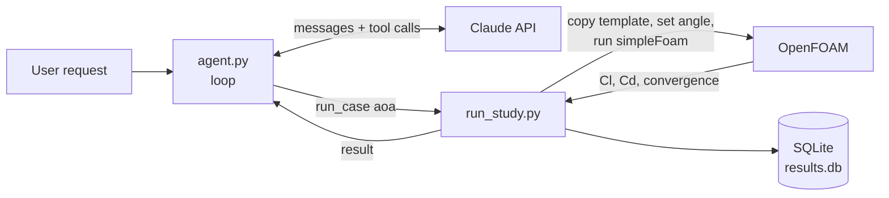

# CFD LLM Agent

An LLM agent that plans and runs CFD parameter studies on its own. You give it a question, it decides which simulations to run, runs them in a sandboxed Docker container, judges the results and answers.

Example: *"Find the angle of attack with maximum L/D for this airfoil."*

<!-- TODO: demo GIF here -->

## Result

In a first study, the agent found the optimum in **9 simulations**:

| AoA (°) | Cl | Cd | L/D |
|---|---|---|---|
| 0 | 0.143 | 0.0100 | 14.3 |
| 3 | 0.466 | 0.0136 | 34.2 |
| 4.5 | 0.624 | 0.0169 | 36.8 |
| **5** | **0.675** | **0.0183** | **36.9** |
| 6 | 0.775 | 0.0214 | 36.3 |
| 8 | 0.948 | 0.0301 | 31.5 |

Strategy it chose by itself: coarse sweep, bracket the peak, parabolic fit to predict the optimum, then confirm on both sides.

<!-- TODO: comparison vs uniform sweep / scipy (runs needed) -->

## How it works



1. `agent.py` sends the request, a system prompt and one tool description to Claude.
2. Claude replies with tool calls like `run_case(aoa=5, reason="parabolic fit predicts peak near 5°")`.
3. `run_study.py` builds the case, runs OpenFOAM, reads Cl/Cd and checks convergence.
4. The result goes back to Claude and is stored in SQLite, including the agent's reason.
5. Repeat until Claude answers without a tool call.

**Design principle:** the LLM only decides. All execution is deterministic Python code that the LLM can trigger but not change.

## Safety

- **One narrow tool.** The agent can only request a simulation at an angle. No shell, no file access.
- **Input validation.** Angles outside -5° to 20° are rejected by the code, not by the prompt.
- **Hard budgets.** Max 15 simulations and 30 loop turns per study, enforced in code.
- **Sandbox.** Everything runs in a Docker container as a non-root user, seeing only the project folder.
- **Honest results.** Non-converged runs are flagged and the agent is told not to base conclusions on them.

## Database

Two tables in `data/results.db`:

- `studies`: one row per study (method, request, start time)
- `runs`: one row per simulation (study, angle, Cl, Cd, L/D, converged, status, the agent's reason)

Every run is logged, so the agent's reasoning can be replayed:

```sql
SELECT aoa, l_d, note FROM runs WHERE study_id = 4 ORDER BY run_id;
```

## Setup

Requirements: Docker, an Anthropic API key.

```bash
git clone https://github.com/<user>/cfd-llm-agent.git
cd cfd-llm-agent
echo "ANTHROPIC_API_KEY=sk-ant-..." > .env
docker build -t cfd-agent .
docker run -it --rm --user $(id -u):$(id -g) --env-file .env \
  -v $(pwd):/projLLM cfd-agent
```

Inside the container:

```bash
cd /projLLM/code
python3 run_study.py 0 4 8                      # manual runs, no LLM
python3 agent.py "Find the angle of attack with maximum L/D."
```

## Project structure

```
code/
  agent.py         agent loop, system prompt, tool definition
  run_study.py     builds, runs and evaluates one case
  db.py            SQLite storage
  plot_residuals.py
cases/
  airFoil2D/       OpenFOAM template (simpleFoam, Spalart-Allmaras)
Dockerfile         OpenFOAM v2412 + Python
requirements.txt
```

## Limitations

- Test case is the OpenFOAM `airFoil2D` tutorial: coarse 2D mesh, steady RANS. Numbers are plausible, not validated.
- Above ~8° the steady solver does not converge on this mesh (onset of separation). Those angles are flagged as unreliable.
- One parameter (angle of attack) so far.

## Stack

Python, Anthropic API (tool calling), OpenFOAM v2412, SQLite, Docker
